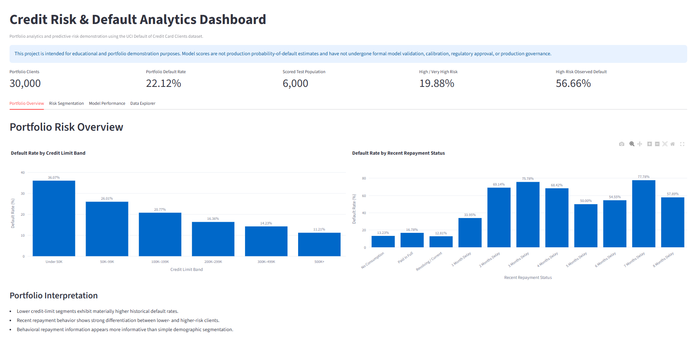
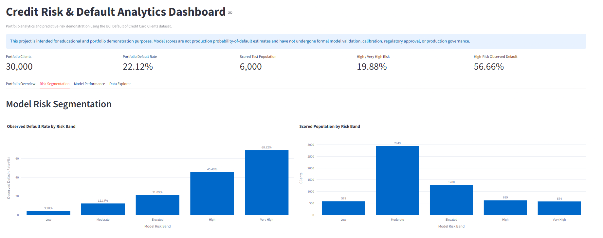
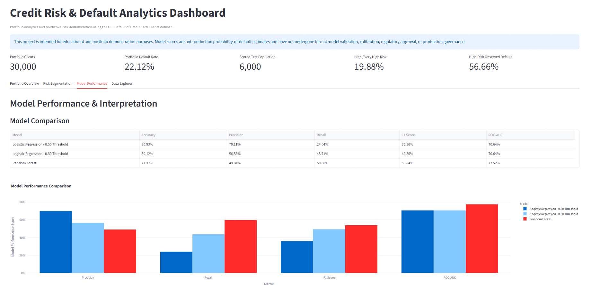
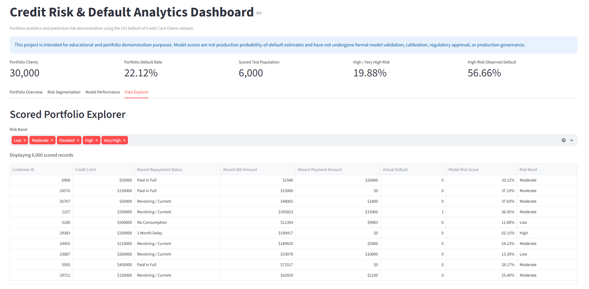
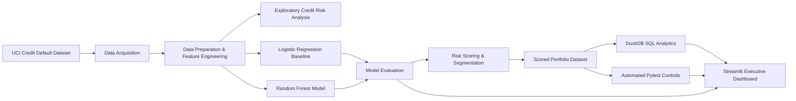

# Credit Risk & Default Analytics

An end-to-end financial-services analytics and machine-learning portfolio project focused on credit-risk segmentation, default prediction, SQL analysis, automated controls, and executive reporting.

The project uses the **UCI Default of Credit Card Clients dataset** and demonstrates how portfolio data can be transformed into actionable credit-risk insights using Python, SQL, machine learning, automated testing, and Streamlit.

> **Portfolio Disclaimer**
>
> This project is intended solely for educational and portfolio demonstration purposes. Model scores are not production probability-of-default estimates and have not undergone formal model validation, calibration, regulatory approval, or production governance.

---

## Project Overview

The project analyzes a portfolio of **30,000 credit-card clients** to identify patterns associated with next-month default risk.

The workflow includes:

- Data acquisition and preparation
- Exploratory credit-risk analysis
- Feature engineering
- Logistic Regression baseline modeling
- Random Forest predictive modeling
- Probability-threshold analysis
- Model risk segmentation
- SQL portfolio analytics using DuckDB
- Automated data and scoring controls using Pytest
- Interactive executive reporting using Streamlit

The portfolio-wide observed default rate is **22.12%**.

---

## Key Results

### Portfolio Risk

Lower credit-limit segments exhibit materially higher historical default rates.

| Credit Limit Band | Default Rate |
|---|---:|
| Under 50K | 36.07% |
| 50K–99K | 26.01% |
| 100K–199K | 20.77% |
| 200K–299K | 16.36% |
| 300K–499K | 14.23% |
| 500K+ | 11.21% |

Recent repayment behavior also provides strong risk differentiation, with delinquent customers exhibiting substantially higher observed default rates.

---

## Predictive Modeling

Two models were evaluated:

| Model | Accuracy | Precision | Recall | F1 Score | ROC-AUC |
|---|---:|---:|---:|---:|---:|
| Logistic Regression – 0.50 Threshold | 80.93% | 70.11% | 24.04% | 35.80% | 70.64% |
| Logistic Regression – 0.30 Threshold | 80.12% | 56.53% | 43.71% | 49.30% | 70.64% |
| Random Forest | 77.37% | 49.04% | **59.68%** | **53.84%** | **77.52%** |

The Logistic Regression model provides an interpretable benchmark, while Random Forest demonstrates stronger overall discrimination and substantially higher recall for actual defaults.

For credit-risk screening, this tradeoff is important because overall accuracy alone can mask poor identification of higher-risk clients.

---

## Risk Segmentation

Random Forest scores were converted into portfolio risk bands for demonstration and analytics purposes.

| Risk Band | Clients | Observed Default Rate |
|---|---:|---:|
| Low | 578 | 3.98% |
| Moderate | 2,949 | 12.14% |
| Elevated | 1,280 | 21.09% |
| High | 619 | 45.40% |
| Very High | 574 | 68.82% |

The strong monotonic increase in observed default rates demonstrates meaningful risk ranking across the scored population.

High and Very High risk clients represent approximately **19.88% of the scored population**, with a combined observed default rate of approximately **56.66%**.

These bands are model-generated analytical segments and should not be interpreted as regulatory credit grades or formally calibrated probability-of-default categories.

---

## Feature Importance

Recent repayment behavior emerged as the strongest predictive signal in the Random Forest model.

The most influential variables include:

- Most recent repayment status
- Prior-month repayment status
- Credit limit
- Recent payment amounts
- Recent billing amounts

Feature importance represents predictive contribution and does not imply causality.

---

## Executive Dashboard

### Portfolio Overview



The Portfolio Overview presents portfolio-level default metrics, credit-limit segmentation, and recent repayment behavior.

### Risk Segmentation



The Risk Segmentation view demonstrates how observed default rates increase across model-generated risk bands.

### Model Performance



The Model Performance view compares Logistic Regression and Random Forest across precision, recall, F1 score, and ROC-AUC.

### Scored Portfolio Explorer



The Data Explorer enables interactive review of scored customers by risk band, repayment behavior, credit exposure, actual default outcome, and model risk score.

---

## SQL Analytics

DuckDB is used as an independent SQL analytics layer.

The SQL workflow evaluates:

- Overall portfolio population and default rate
- Default rate by credit-limit segment
- Recent repayment behavior
- Model risk-band performance
- High-risk portfolio concentration
- Credit-limit exposure within higher-risk segments

SQL outputs are stored under:

```text
reports/sql_outputs/
```

This provides an independent reconciliation layer between Python-based analytics and SQL-based portfolio reporting.

---

## Automated Controls

The project includes automated Pytest controls covering:

- Processed portfolio record count
- Scored test population count
- Portfolio default-rate reconciliation
- Customer-ID uniqueness
- Valid model probability ranges
- Valid risk-band classifications
- Required scoring-field completeness
- Increasing observed risk across risk bands
- Presence of a high-risk population
- Elevated observed default rate within the high-risk population

Current test result:

```text
10 passed
```

Run the test suite with:

```bash
pytest -v
```

---

## Project Architecture



---

## Repository Structure

```text
credit-risk-default-analytics/
│
├── app.py
├── requirements.txt
│
├── data/
│   ├── raw/
│   │   ├── uci_credit_default_raw.csv
│   │   └── uci_variable_dictionary.csv
│   │
│   └── processed/
│       ├── credit_default_processed.csv
│       └── credit_risk_scored_test.csv
│
├── notebooks/
│   ├── 01_credit_risk_exploration.ipynb
│   └── 02_credit_risk_modeling.ipynb
│
├── reports/
│   ├── feature_importance.csv
│   ├── model_comparison.csv
│   │
│   ├── screenshots/
│   │   ├── portfolio_overview.png
│   │   ├── risk_segmentation.png
│   │   ├── model_performance.png
│   │   └── data_explorer.png
│   │
│   └── sql_outputs/
│       ├── overall_portfolio_summary.csv
│       ├── credit_limit_risk_summary.csv
│       ├── repayment_status_summary.csv
│       ├── risk_band_summary.csv
│       └── high_risk_concentration.csv
│
├── sql/
│   └── credit_risk_analysis.sql
│
├── src/
│   ├── download_uci_credit_data.py
│   ├── prepare_credit_data.py
│   └── run_sql_analysis.py
│
└── tests/
    └── test_credit_risk.py
```

---

## Technology Stack

**Python** — data processing and analytical workflow  
**Pandas / NumPy** — data preparation and analysis  
**Scikit-learn** — Logistic Regression and Random Forest modeling  
**Plotly** — interactive visualizations  
**DuckDB / SQL** — independent portfolio analytics  
**Pytest** — automated data and model controls  
**Jupyter Notebook** — exploratory analysis and model development  
**Streamlit** — interactive executive dashboard  
**Git / GitHub** — version control and portfolio presentation

---

## Running the Project

Create and activate a Python virtual environment, then install the project dependencies:

```bash
pip install -r requirements.txt
```

Prepare the source data:

```bash
python src/download_uci_credit_data.py
python src/prepare_credit_data.py
```

Run the SQL analytics layer:

```bash
python src/run_sql_analysis.py
```

Run automated controls:

```bash
pytest -v
```

Launch the dashboard:

```bash
streamlit run app.py
```

The dashboard will normally be available locally at:

```text
http://localhost:8501
```

---

## Business Interpretation

This project demonstrates an analytical workflow that moves beyond simply building a predictive model.

The objective is to connect data quality, portfolio analytics, model performance, risk segmentation, SQL validation, automated controls, and executive reporting into a single reproducible framework.

From a financial-services perspective, the analysis demonstrates how repayment behavior, exposure characteristics, and predictive analytics can support portfolio monitoring, risk identification, prioritization, and management decision-making.

---

## Important Model Governance Note

The predictive models and risk bands in this project are demonstrations only.

A production credit-risk model would require additional activities including independent validation, probability calibration, stability monitoring, bias and fairness assessment, explainability analysis, data lineage and control validation, documented model limitations, approval processes, ongoing performance monitoring, and formal model-risk governance.

---

## Author

**Komil Fazilov**

Financial Services | Quality & Technology Delivery | Data Governance | Risk Analytics | UAT & Quality Engineering